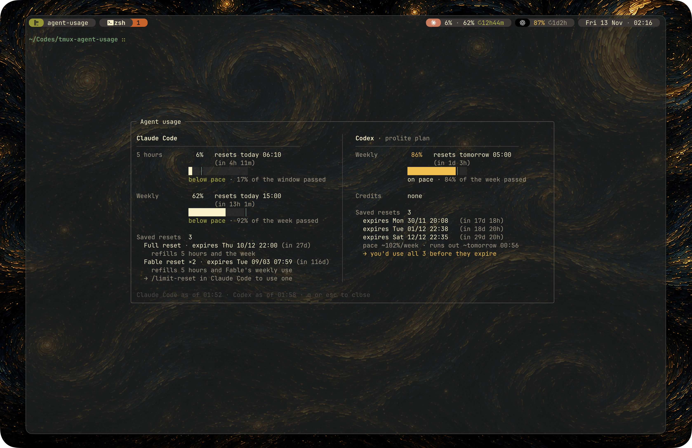

# tmux-agent-usage

Subscription usage for AI coding agents in your tmux status line, with a
details popup one key away. Supports Claude Code and Codex today.



- **Status line bodies** such as `7% · 2%` for Claude (5-hour · 7-day) and
  `28%` for Codex. Values turn yellow from 70% and red from 90%, and show the
  time to reset when it matters (`87% ↻1h20m`).
- **A details popup** (`prefix A`) with reset times, usage bars, your pace and,
  for each agent, the saved resets you still have.
- **Your theme stays yours.** The plugin fills one placeholder per agent;
  labels, icons, colors and placement are up to you.
- **Local first.** Percentages come from files the official clients already
  write. Nothing is sent anywhere to show the status line.

## Will your limit last?

A percentage alone doesn't answer that: 60% used is a lot one hour into the
week and very little on day six. The popup compares how much of the limit
you've used with how much of the window has passed:

```text
Weekly         87%   resets Sun 15/11 12:00
              █████████│████░░
              above pace · runs out ~tomorrow 02:20
```

The bar fills with your usage, and `│` marks how far into the window you are.
Fill past the marker means you're spending faster than time passes.

- **below pace**: you're using less than the time passed; the limit lasts and
  some of it may go unused.
- **on pace**: usage and time are moving together, within 15%.
- **above pace**: at your rate so far, you'll hit the limit at the time shown,
  before the reset.

The same projection tells you whether your saved resets would be used before
they expire. [How pace is calculated](docs/how-it-works.md#pace).

## Supported agents

| Agent | Placeholder | Setup | Saved resets in the popup |
| --- | --- | --- | --- |
| [Claude Code](https://code.claude.com) 2.1.80+ | `#{agent_usage_claude}` | One `statusLine` entry ([below](#claude-code)) | Opt-in |
| [Codex CLI](https://github.com/openai/codex) | `#{agent_usage_codex}` | None | Codex 0.141.0+ |

Use any of them, alone or together. More agents are planned: each one is a
placeholder and a popup column. [Open an issue](https://github.com/ramonmello/tmux-agent-usage/issues)
to ask for yours.

## Requirements

- tmux 3.4 or later, on macOS or Linux (WSL: run tmux and the agents in the
  same Linux distribution).
- For TPM installs: curl, tar and `sha256sum` or `shasum`. No compiler needed.

## Install

### With TPM (recommended)

Add the plugin and put the placeholders where you want the usage to appear,
before your TPM initialization line:

<!-- test:tpm-managed -->
```tmux
set -g @plugin 'ramonmello/tmux-agent-usage'
set -g @agent-usage-agents 'claude codex'
set -g status-right 'Claude #{agent_usage_claude} | Codex #{agent_usage_codex}'
```

Press `prefix I`. The plugin downloads the release binary matching its
version, verifies its checksum and keeps it inside the plugin directory.
Updating the plugin with TPM (`prefix U`) updates the binary too.

### With Homebrew or Cargo

Install the binary yourself, then tell the plugin to use it:

<!-- test:homebrew -->
```sh
brew install ramonmello/tap/tmux-agent-usage
printf '%s/bin/tmux-agent-usage\n' "$(brew --prefix)"
```

<!-- test:cargo-registry -->
```sh
cargo install --locked tmux-agent-usage --version 0.1.0
```

<!-- test:tpm-external -->
```tmux
set -g @agent-usage-bin '/your/chosen/root/bin/tmux-agent-usage'
```

Use the path Homebrew printed, or `~/.cargo/bin/tmux-agent-usage` for Cargo.
TPM never downloads or updates an executable you chose: upgrade it with
`brew upgrade tmux-agent-usage` or by rerunning `cargo install` with the new
version. You can also skip TPM entirely; see
[configuration without TPM](docs/configuration.md#without-tpm).

## Agent setup

### Claude Code

**Claude percentages need this step.** Claude Code only hands its usage
numbers to its status line command, so the plugin records them from there.
Merge this into `~/.claude/settings.json`:

<!-- test:tap-only -->
```json
{
  "statusLine": {
    "type": "command",
    "command": "\"/your/chosen/root/bin/tmux-agent-usage\" claude-tap",
    "padding": 0
  }
}
```

Replace the path with your binary's stable path:

| Installed with | Path |
| --- | --- |
| TPM | `$HOME/.tmux/plugins/tmux-agent-usage/bin/tmux-agent-usage` (or under `~/.config/tmux/plugins/` if your plugins live there) |
| Homebrew | The path printed above, such as `/opt/homebrew/bin/tmux-agent-usage` |
| Cargo | `$HOME/.cargo/bin/tmux-agent-usage` |

Already using a status line command? Put it after `--`; the tap passes the
input through and keeps its output and exit code:

<!-- test:tap-wrapped -->
```json
{
  "statusLine": {
    "type": "command",
    "command": "\"/your/chosen/root/bin/tmux-agent-usage\" claude-tap -- ccstatusline",
    "padding": 0
  }
}
```

The numbers appear after Claude Code's next reply.

### Codex

No setup needed: the plugin reads the usage Codex already writes to its
session logs.

## Configure

The most common settings, set before the plugin loads:

```tmux
set -g @agent-usage-agents 'codex'          # popup agents and their order
set -g @agent-usage-popup-key 'u'           # prefix u; 'none' disables it
set -g @agent-usage-style-high 'fg=#fabd2f' # status colors, per role
set -g @agent-usage-popup-accent '#83a598'  # popup colors
set -g @agent-usage-claude-resets 'on'      # opt in to Claude saved resets
```

To show one agent, keep only its placeholder and list only it in
`@agent-usage-agents`. Every option, the command-line flags, clickable segments
and themed examples are in the [configuration reference](docs/configuration.md).

## Privacy

The status line reads only local files each agent already writes, such as the
snapshots `claude-tap` records for Claude Code and Codex's session logs. Only
opening the popup asks for saved resets: through `codex app-server` for Codex
and, if you opt in, an undocumented Claude Code endpoint for Claude. Tokens are never logged or cached. Details are in
[how it works](docs/how-it-works.md).

## Troubleshooting

`tmux-agent-usage inspect` shows what the plugin found. An empty status line, `–`,
`couldn't check` and other symptoms are covered in
[troubleshooting](docs/troubleshooting.md).

## Contributing

Bug reports and pull requests are welcome. See
[CONTRIBUTING.md](CONTRIBUTING.md) for building and testing, and the
[changelog](CHANGELOG.md) for what changed.

## Support

If the plugin is useful to you, you can support its development:

<a href="https://buymeacoffee.com/ramonmello"></a>

## License

[MIT](LICENSE). The license covers this project's code. It grants no rights to
third-party names, trademarks or logos; no fonts or brand artwork are
distributed.
